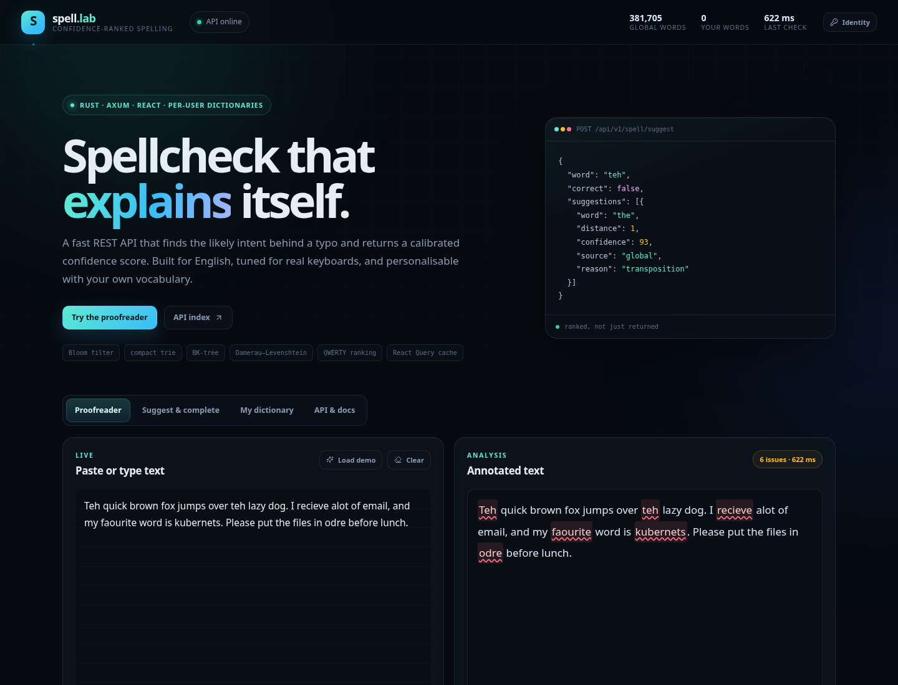
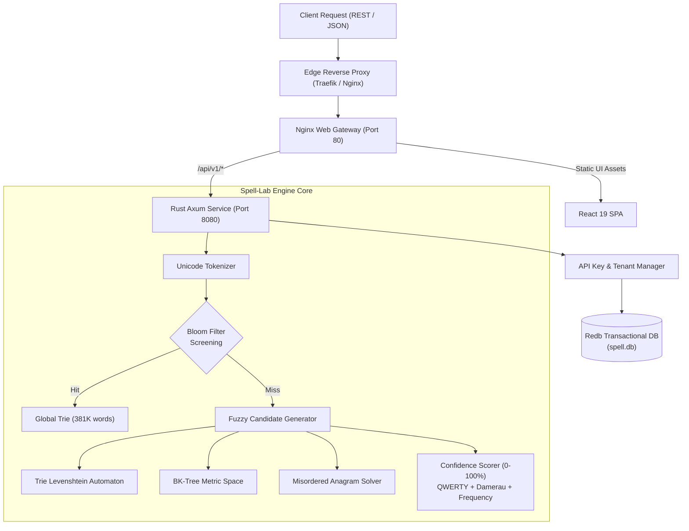

# spell-lab

[](LICENSE)
[](https://www.rust-lang.org)
[](https://react.dev)
[](https://www.typescriptlang.org)

High-performance, confidence-ranked spellcheck and correction REST API built in **Rust** with an interactive **React** web testing interface.

Features native per-user isolated custom dictionaries, multi-layered spellcheck algorithmic pipelines (Bloom Filter, Compact Prefix Trie, BK-Tree metric space, Damerau-Levenshtein transposition awareness, and QWERTY proximity weighting), with sub-millisecond query responses.



---

## Table of Contents

- [Key Highlights](#key-highlights)
- [Architecture & Design](#architecture--design)
- [Real-World API Usage & Parameters](#real-world-api-usage--parameters)
  - [1. Authentication](#1-authentication)
  - [2. Multi-Token Spellcheck (`/api/v1/spell/check`)](#2-multi-token-spellcheck-apiv1spellcheck)
  - [3. Single-Word Suggestions (`/api/v1/spell/suggest`)](#3-single-word-suggestions-apiv1spellsuggest)
  - [4. Prefix Autocompletion (`/api/v1/spell/complete`)](#4-prefix-autocompletion-apiv1spellcomplete)
  - [5. One-Click Auto-Correction (`/api/v1/spell/correct`)](#5-one-click-auto-correction-apiv1spellcorrect)
  - [6. User Dictionary & Bulk Operations (`/api/v1/dictionary/*`)](#6-user-dictionary--bulk-operations-apiv1dictionary)
  - [7. Telemetry & Observability (`/api/v1/metrics`, `/api/v1/stats`)](#7-telemetry--observability-apiv1metrics-apiv1stats)
- [Deployment Guide](#deployment-guide)
  - [Native Systemd Service (Local)](#native-systemd-service-local)
  - [Docker Compose](#docker-compose)
  - [Reverse Proxy & TLS Termination](#reverse-proxy--tls-termination)
- [Testing & Quality Assurance](#testing--quality-assurance)
- [License](#license)

---

## Key Highlights

- **Multi-Algorithm Pipeline**:
  - **Bloom Filter**: Instant $O(1)$ rejection of non-words without traversing large tree structures.
  - **Compact Prefix Trie**: Fast prefix search, autocompletion, and Levenshtein automaton matching.
  - **BK-Tree (Burkhard-Keller Metric Tree)**: Discrete metric tree partitioned by Levenshtein distance for fuzzy search.
  - **Misordered Word & Transposition Awareness**: Detects adjacent and distant transpositions (e.g. `ehad` $\rightarrow$ `head`).
  - **QWERTY Spatial Distance**: Keyboard neighbor distance penalties (e.g. typing `w` instead of `e` incurs a much lower penalty than `p`).
  - **Frequency-Weighted Confidence Ranking**: Scores suggestions from $0$ to $100\%$ using a combination of edit distance, QWERTY geometry, source priority, and Google Web Trillion corpus unigram frequencies.
- **Isolated Per-User Dictionaries**:
  - User custom jargon, acronyms, and names are indexed separately using embedded transactional storage ([`redb`](https://github.com/cberner/redb)).
  - Fast in-memory user lexicon caching with atomic invalidation on updates.
  - Bulk word import (newline, CSV, JSON) and multi-format export (`.txt`, `.csv`, `.json`).
- **Production Observability & Metrics**:
  - Real-time telemetry via `GET /api/v1/metrics`: Resident Set Size (RSS), Peak HWM, Virtual memory, thread count, system load averages, and suggestion cache hit rates.
- **Cloud & Container Ready**:
  - Runs with zero dependencies or containerized via Docker on x86_64 and ARM64 (aarch64).

---

## Architecture & Design

For an in-depth exploration of algorithms, data structures, and database schema, see [docs/ARCHITECTURE.md](docs/ARCHITECTURE.md).



---

## Real-World API Usage & Parameters

All endpoints accept and return UTF-8 JSON. Responses include an `elapsedMs` timing parameter measuring execution latency.

### 1. Authentication

Include your API key via HTTP request headers:
- `X-API-Key: <your_api_key>` or `Authorization: Bearer <your_api_key>`

> Public requests without an API key query the global 381,705-word lexicon. Authenticated requests consult both the global lexicon and personal isolated vocabulary.

---

### 2. Multi-Token Spellcheck (`/api/v1/spell/check`)

Scans a multi-word paragraph or sentence, tokenizes words, detects typos, and provides ranked suggestions for each token.

#### Endpoint
`POST /api/v1/spell/check`

#### Request Parameters (JSON Body)

| Parameter | Type | Required | Default | Description |
|---|---|---|---|---|
| `text` | `string` | **Yes** | — | Raw input string to spellcheck (up to 20,000 characters). |
| `maxSuggestions` | `integer` | No | `5` | Maximum number of candidate suggestions returned per misspelled token (clamped 1 to 20). |
| `maxDistance` | `integer` | No | `2` | Maximum allowable Damerau-Levenshtein edit distance for candidate matching (clamped 1 to 3). |
| `minConfidence` | `float` | No | `0.0` | Minimum score threshold ($0.0$ to $100.0$) a candidate must reach to be included in suggestions. |
| `includeUserDictionary` | `boolean` | No | `true` | Searches personal dictionary before the global corpus when an API key is provided. |
| `ignoreAcronyms` | `boolean` | No | `true` | When `true`, tokens consisting purely of uppercase letters (e.g. `NASA`, `REST`, `JSON`) are marked valid. |

#### Example Request
```bash
curl -s -X POST https://spell.example.com/api/v1/spell/check \
  -H "X-API-Key: sl_b5835ea79e..." \
  -H "Content-Type: application/json" \
  -d '{
    "text": "Teh kubernetes clustr is runing smoothly.",
    "maxSuggestions": 3,
    "maxDistance": 2,
    "minConfidence": 70.0,
    "includeUserDictionary": true,
    "ignoreAcronyms": true
  }'
```

#### Example Response
```json
{
  "text": "Teh kubernetes clustr is runing smoothly.",
  "tokens": [
    {
      "raw": "Teh",
      "normalized": "teh",
      "start": 0,
      "end": 3,
      "byteStart": 0,
      "byteEnd": 3,
      "correct": false,
      "ignored": false,
      "inUserDictionary": false,
      "suggestions": [
        {
          "word": "The",
          "distance": 1,
          "confidence": 92,
          "frequency": 22761659,
          "source": "global",
          "reason": "transposition"
        }
      ]
    },
    {
      "raw": "kubernetes",
      "normalized": "kubernetes",
      "start": 4,
      "end": 14,
      "byteStart": 4,
      "byteEnd": 14,
      "correct": true,
      "ignored": false,
      "inUserDictionary": true,
      "suggestions": []
    }
  ],
  "stats": {
    "totalTokens": 6,
    "correctWords": 4,
    "misspelledWords": 2,
    "ignoredWords": 0,
    "suggestionCount": 5,
    "textChars": 41,
    "elapsedMs": 1.25
  },
  "dictionary": {
    "globalWords": 381705,
    "userWords": 13,
    "userDictionaryIncluded": true
  }
}
```

---

### 3. Single-Word Suggestions (`/api/v1/spell/suggest`)

Used for fast, targeted candidate lookup on a single token.

#### Endpoint
`POST /api/v1/spell/suggest`

#### Request Parameters (JSON Body)

| Parameter | Type | Required | Default | Description |
|---|---|---|---|---|
| `word` | `string` | **Yes** | — | Word token to evaluate (1 to 64 ASCII/Unicode characters). |
| `maxSuggestions` | `integer` | No | `5` | Maximum number of candidates returned. |
| `maxDistance` | `integer` | No | `2` | Maximum allowable edit distance. |
| `minConfidence` | `float` | No | `0.0` | Minimum confidence score ($0.0$ to $100.0$). |
| `includeUserDictionary` | `boolean` | No | `true` | Include authenticated user words. |

#### Example Request
```bash
curl -s -X POST https://spell.example.com/api/v1/spell/suggest \
  -H "Content-Type: application/json" \
  -d '{
    "word": "odre",
    "maxSuggestions": 3,
    "minConfidence": 75.0
  }'
```

---

### 4. Prefix Autocompletion (`/api/v1/spell/complete`)

Instant prefix-based completion powered by the Compact Prefix Trie.

#### Endpoint
`GET /api/v1/spell/complete?prefix=<str>&limit=<int>&includeUserDictionary=<bool>`

#### Example Request
```bash
curl -s "https://spell.example.com/api/v1/spell/complete?prefix=kube&limit=3"
```

---

### 5. One-Click Auto-Correction (`/api/v1/spell/correct`)

Applies top-ranked corrections across the entire text block, returning both the clean corrected text and a structured list of exact character-range diffs.

#### Endpoint
`POST /api/v1/spell/correct`

#### Example Request
```bash
curl -s -X POST https://spell.example.com/api/v1/spell/correct \
  -H "Content-Type: application/json" \
  -d '{
    "text": "Teh fastpai server is runing.",
    "minConfidence": 80.0
  }'
```

---

### 6. User Dictionary & Bulk Operations (`/api/v1/dictionary/*`)

#### Create Identity (`POST /api/v1/users`)
```bash
curl -s -X POST https://spell.example.com/api/v1/users \
  -H "Content-Type: application/json" \
  -d '{"name": "Engineering Team"}'
```

#### Bulk Import (`POST /api/v1/dictionary/import` or `POST /api/v1/dictionary/words`)
Supports importing up to **50,000 words** in a single transaction via an array or raw text payload:
```bash
curl -s -X POST https://spell.example.com/api/v1/dictionary/import \
  -H "X-API-Key: <your_key>" \
  -H "Content-Type: application/json" \
  -d '{
    "text": "kubernetes, grafana\ntailscale\nprometheus, argocd"
  }'
```

#### Bulk Export (`GET /api/v1/dictionary/export`)
```bash
# Export as plain newline-delimited text
curl -s "https://spell.example.com/api/v1/dictionary/export?format=txt" -H "X-API-Key: <key>" -o dictionary.txt

# Export as CSV
curl -s "https://spell.example.com/api/v1/dictionary/export?format=csv" -H "X-API-Key: <key>" -o dictionary.csv

# Export as JSON with user metadata
curl -s "https://spell.example.com/api/v1/dictionary/export?format=json" -H "X-API-Key: <key>" -o dictionary.json
```

#### Delete Single Word (`DELETE /api/v1/dictionary/words/{word}`)
```bash
curl -s -X DELETE https://spell.example.com/api/v1/dictionary/words/argocd -H "X-API-Key: <key>"
```

#### Clear Entire Dictionary (`DELETE /api/v1/dictionary`)
```bash
curl -s -X DELETE https://spell.example.com/api/v1/dictionary -H "X-API-Key: <key>"
```

---

### 7. Telemetry & Observability (`/api/v1/metrics`, `/api/v1/stats`)

`GET /api/v1/metrics` provides sub-millisecond process insights without heavy external agents:
```bash
curl -s https://spell.example.com/api/v1/metrics
```
```json
{
  "version": "0.1.0",
  "apiVersion": "v1",
  "uptimeSeconds": 1420,
  "memory": {
    "residentMb": 79.7,
    "peakResidentMb": 90.68,
    "virtualMb": 420.89,
    "threads": 6
  },
  "systemLoad": [0.45, 0.72, 0.88],
  "globalWords": 381705,
  "users": 7,
  "userWords": 16,
  "suggestionCache": {
    "entries": 128,
    "capacity": 10000,
    "hits": 1450,
    "misses": 128,
    "hitRate": 0.918
  }
}
```

---

## Deployment Guide

### Native Systemd Service (Local)

1. Build the release binary:
   ```bash
   cargo build --release
   ```
2. Enable and start the systemd service:
   ```bash
   systemctl --user enable --now spell-lab.service
   ```

### Docker Compose

Run the multi-stage stack (Rust API + Nginx SPA):
```bash
docker compose up -d --build
```

### Reverse Proxy & TLS Termination

When deploying behind Traefik, Nginx, or Caddy:
- Point reverse proxy to port `80` of the `web` container.
- For Traefik, see sample overlay in [`deploy/docker-compose.traefik.yml`](deploy/docker-compose.traefik.yml) and dynamic config in [`deploy/spell-lab.yml`](deploy/spell-lab.yml).

---

## Testing & Quality Assurance

Run test suites:
```bash
# Rust core engine tests (Bloom filter, Trie, BK-Tree, Levenshtein, Redb)
cargo test

# Web TypeScript compilation & bundle verification
cd web && npm run build
```

---

## License

MIT License. See [LICENSE](LICENSE) for details.
