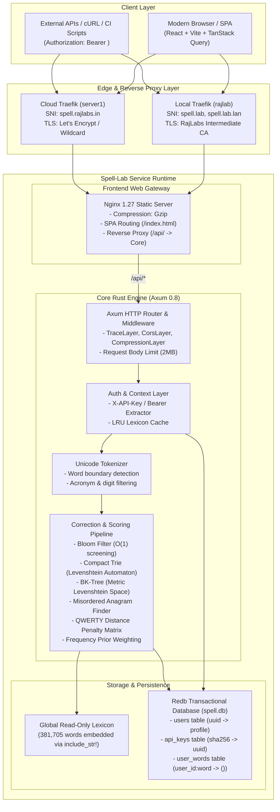
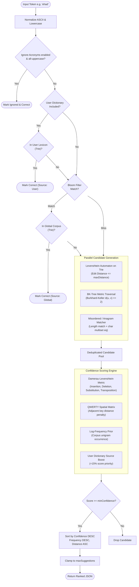
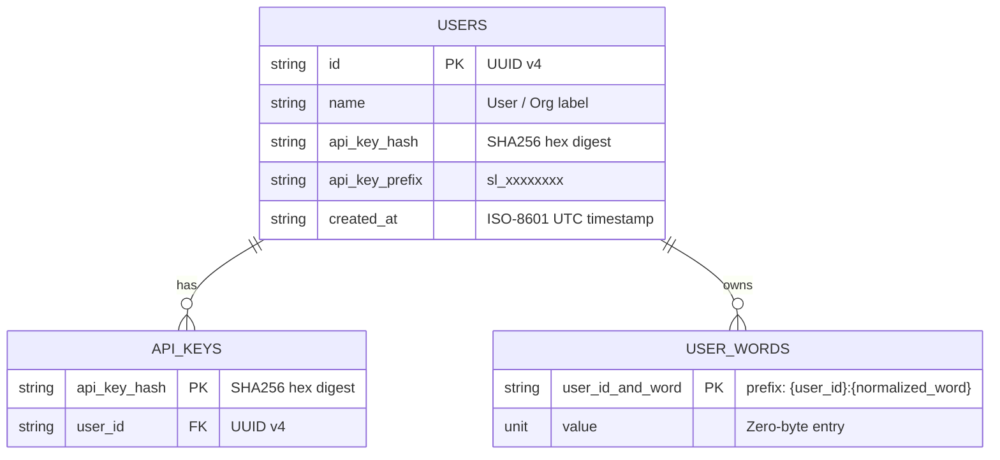
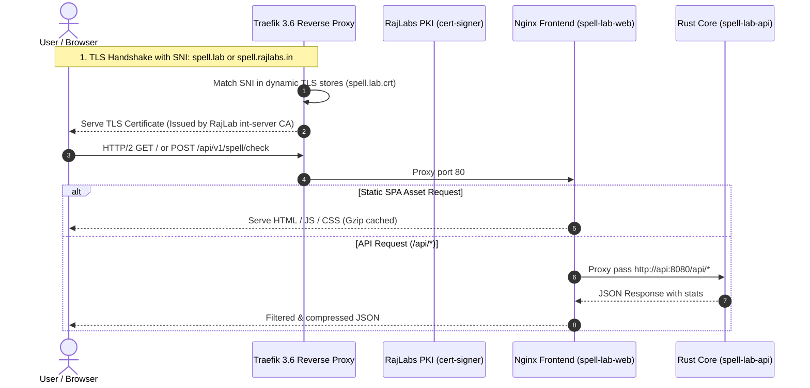

# Architecture Deep Dive — Spell-Lab

High-performance, confidence-ranked spellchecker and morphological correction engine built in **Rust** (Axum, Rayon, Redb) with an interactive **React** interface.

---

## 1. System Architecture

---

## 2. Spellcheck & Candidate Scoring Pipeline

Every inbound spellcheck or suggest request executes through a deterministic, multi-stage heuristic pipeline:

---

## 3. Data Storage & Multi-Tenant Isolation

User dictionaries and authentication keys are kept isolated in transactional storage powered by [`redb`](https://github.com/cberner/redb):

- **Prefix-range lookups**: All user words are stored under the compound key `{user_id}:{word}`. Range queries scan only the user's specific partition (`range(user_id..)`).
- **Fast In-Memory Cache**: Each user has an in-memory `Arc<Lexicon>` constructed on first query and stored in a synchronized `RwLock<HashMap<String, Arc<Lexicon>>>`. Invalidation occurs immediately on word additions, removals, or bulk clears.

---

## 4. Edge Traefik & TLS Certificate Architecture

